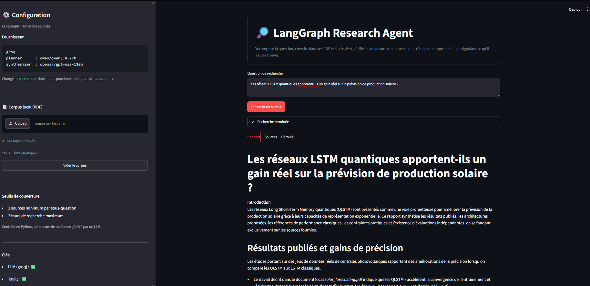
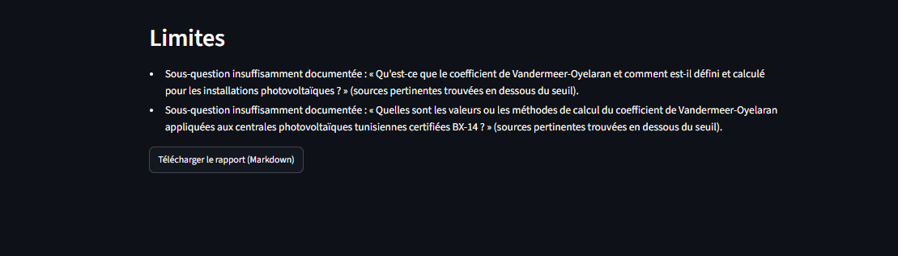
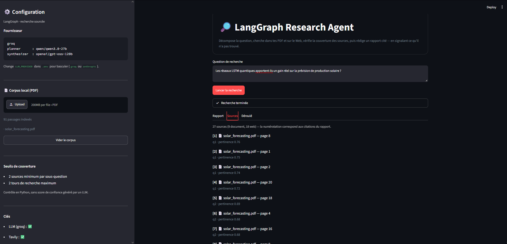
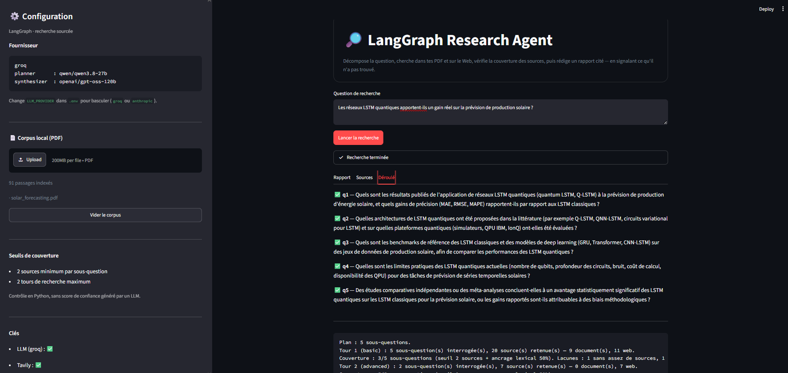
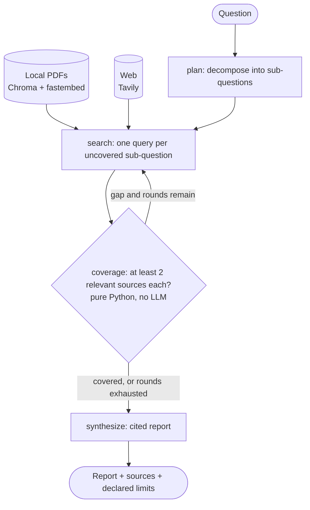
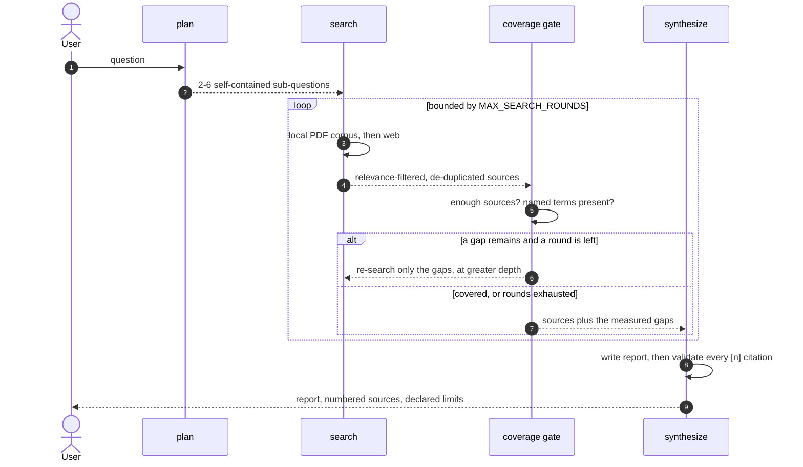
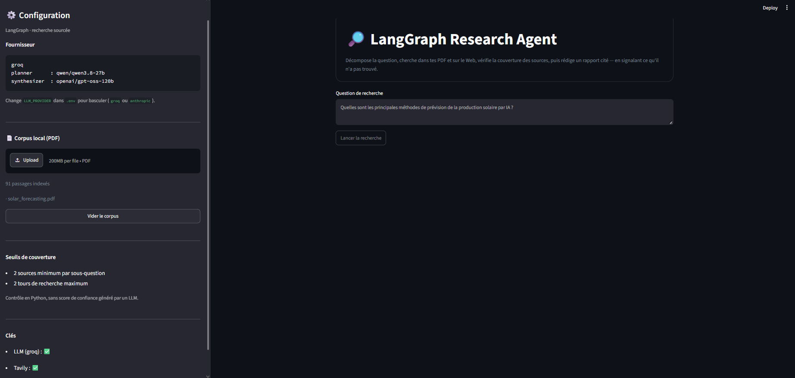

<h1 align="center">LangGraph AI Research Agent</h1>

<p align="center">
  A research agent that decomposes a question, searches your PDFs and the web,
  <br/>and <strong>declares what it could not find instead of inventing it</strong>.
</p>

<p align="center">
  
  
  
  
  
  
  
</p>



---

## The idea

Most retrieval agents answer every question, because nothing in them can tell the
difference between *finding sources* and *finding an answer*. This one can.

**The graph's control point is measured, not generated.** A pure-Python node checks
two conditions per sub-question — enough sources above a relevance floor, and the
things the question actually names appearing in those sources — then decides whether
to search again. No model is ever asked to score its own confidence.

When a sub-question survives both search rounds unanswered, it is named in the
report's limitations section, built in Python so the model cannot soften it:



## Features

- **Query decomposition** - a planner turns one question into self-contained, searchable sub-questions.
- **Hybrid retrieval per sub-question** - a local PDF corpus (Chroma + fastembed) and web search (Tavily), merged into one numbered citation list. Web sources are checkable by URL, document sources by file and page.
- **Multilingual embeddings**, so a question in French retrieves from an English paper. Embedding runs locally: neither Groq nor Anthropic serves an embeddings endpoint.
- **Relevance filtering** per retriever, each on its own scale, so weak hits never reach the coverage gate.
- **Measured coverage gate** - plain Python counts sources per sub-question; a shortfall triggers a *targeted* second round that re-searches only the gaps, at greater depth.
- **Bounded retries** - the loop is capped, so an unanswerable sub-question ships as a declared limitation rather than looping forever.
- **Citation validation** - any `[n]` the model emits outside the real source range is detected and flagged in the report.
- **Structural honesty** - the limitations section is assembled in Python from the measured gaps, so it cannot be forgotten or softened by the model.
- **Provider seam** - nodes request a *role* (`planner`, `synthesizer`), not a vendor; switching Groq to Anthropic is one environment variable.
- **Automated tests** covering every non-LLM decision in the workflow.
- **Secret-safe Git setup** using `.env.example` and `.gitignore`.

## How it looks

<table>
<tr>
<td width="50%"><br/>
<sub><b>Sources</b> — local PDF passages and web results in one numbered list, matching the report's citations.</sub></td>
<td width="50%"><br/>
<sub><b>Trace</b> — the coverage verdict and the targeted second search round.</sub></td>
</tr>
</table>

## Architecture



### Workflow, from question to report

The same graph seen as a sequence. The only branch point is the coverage gate, and it is
the one node that contains no model call.



### Project structure

```text
langgraph-ai-agent/
├── app.py
├── agent/
│   ├── __init__.py
│   ├── graph.py        # wiring: plan -> search -> coverage -> synthesize
│   ├── planner.py      # question -> sub-questions (structured output)
│   ├── search.py       # hybrid retrieval, relevance filtering, de-duplication
│   ├── documents.py    # PDF ingestion, chunking, vector index, local search
│   ├── coverage.py     # the two-condition gate and the router (no LLM)
│   ├── synthesis.py    # cited report, citation validation, limits section
│   ├── llm.py          # provider seam: role -> model
│   └── state.py        # shared graph state
├── evaluation/
│   ├── dataset.py      # the fixed question set and labelled gold pages
│   ├── metrics.py      # recall@k, coverage, citation validity (pure functions)
│   ├── run.py          # the runner; writes measured results
│   └── results/        # every run, kept
├── tests/
│   ├── test_research.py   # planner, coverage gate, routing, synthesis
│   ├── test_documents.py  # chunking, hashing, local relevance floor
│   └── test_metrics.py    # the evaluation metrics themselves
├── assets/
│   └── screenshots/
├── .env.example
├── .gitignore
├── requirements.txt
└── README.md
```

## Requirements

- Python 3.10 or newer (Python 3.11 recommended)
- Git
- A Groq API key: https://console.groq.com/keys

## Run locally on Windows

Open PowerShell in the folder where you keep your projects.

```powershell
git clone https://github.com/sofienkrir/langgraph-ai-agent.git
cd langgraph-ai-agent

python -m venv .venv
.\.venv\Scripts\Activate.ps1

python -m pip install --upgrade pip
pip install -r requirements.txt
Copy-Item .env.example .env
notepad .env
```

In `.env`, replace the placeholder with your own key:

```dotenv
GROQ_API_KEY=your_real_groq_api_key
```

Save the file, then start the application:

```powershell
streamlit run app.py
```

Streamlit should open the app in your browser. You can also open the local URL printed in the terminal, usually `http://localhost:8501`.

> If PowerShell blocks activation, run `Set-ExecutionPolicy -Scope Process -ExecutionPolicy Bypass` in that terminal, then activate the environment again. This only changes the policy for the current PowerShell process.



## Run tests

The unit tests do not need a Groq API key because they test the local tools directly.

```powershell
pytest -q
```

## Try these prompts

1. `Quelles sont les principales méthodes de prévision de la production solaire par IA ?`
2. `Comment le stockage par batteries est-il dimensionné dans les centrales photovoltaïques ?`
3. `Quelles approches de maintenance prédictive existent pour les éoliennes ?`

Ask something deliberately obscure to see the honest-gap behaviour. For a question naming a metric that does not exist, the report ships with each uncovered sub-question named in its limitations section, and says which condition failed — too few sources, or sources that never mention what the question names:

> Sous-question insuffisamment documentée : « Qu'est-ce que le coefficient de Vandermeer-Oyelaran […] ? » — des sources ont été trouvées, mais aucune ne mentionne ce que la question nomme.

## How it works

1. **plan** - the planner model returns structured output: 2-6 self-contained sub-questions, constrained to the scope of the original question. If decomposition fails, the graph degrades to searching the raw question rather than aborting.
2. **search** - one query per sub-question, against the local PDF corpus *and* the web. Results below each retriever's relevance threshold are dropped, and duplicates are removed across rounds. The local corpus is queried first: it costs nothing and is never rate-limited, so the agent still works when the web search is unavailable.
3. **coverage** - plain Python applies two conditions per sub-question: enough sources above the relevance floor, *and* the distinctive things it names (proper nouns, acronyms, codes, years) actually appear in those sources. This is the graph's only control point, and both conditions are checks, not judgements.
4. **routing** - gaps remaining *and* rounds left means search again, targeting only the gaps and raising search depth. Otherwise the graph proceeds to synthesis. The round cap guarantees termination.
5. **synthesize** - the model writes the report against numbered sources and is forbidden from adding knowledge of its own. Afterwards, Python validates every `[n]` citation against the real source list and appends a limitations section built from the measured gaps.

### Why there is no LLM confidence score

A validator that asks a model to rate its own output on a 0-1 scale produces a number that looks like a measurement and is not one: self-assessed LLM confidence is poorly calibrated, and a wrong answer can carry a high score. This project routes on conditions that are verifiable instead, which is why the retry loop and the limitations section can be trusted.

### Why counting sources is not enough

The first version of the gate counted sources and stopped there. The evaluation harness broke it: asked for "le coefficient de Vandermeer-Oyelaran pour les centrales photovoltaïques tunisiennes certifiées BX-14", a question naming a metric and a standard that do not exist, the agent retrieved plenty of plausible solar-energy pages, cleared the count, and reported **full coverage of a question nothing can answer**.

Search relevance measures topical proximity, not evidence. So a second condition was added - and the first attempt at it also failed under measurement. Scoring every content word did not separate answerable from unanswerable questions at all, because common words like "coefficient" and "photovoltaïques" match any solar page and drown the invented names. Restricting the check to *distinctive* terms separated them cleanly:

| | Grounding |
|---|---|
| Answerable questions | 0.80, 0.83, 1.00 |
| Unanswerable question | 0.25 |

Both runs are kept in `evaluation/results/`. The threshold sits at 0.50, between them.

The honest caveat: that separation rests on one unanswerable question. The eval set needs more negative cases before the margin can be called robust.

## Configuration

Models are chosen per *role*, not per vendor, in `agent/llm.py`:

| Role | Groq (default) | Anthropic |
|---|---|---|
| `planner` | `qwen/qwen3.8-27b` | `claude-haiku-5-5` |
| `synthesizer` | `openai/gpt-oss-120b` | `claude-sonnet-5-5` |

Set `LLM_PROVIDER=anthropic` in `.env` (with `ANTHROPIC_API_KEY`) to switch. Nothing else changes: the nodes ask for a role and never name a model.

Thresholds live next to the code that enforces them - `MIN_SOURCES_PER_SUB_QUESTION` and `MAX_SEARCH_ROUNDS` in `agent/coverage.py`, and the per-retriever relevance floors in `agent/search.py` and `agent/documents.py`.

## Security

- Never commit `.env`, API keys, tokens, or credentials.
- `.env.example` contains only a placeholder.
- Keys are read from `.env` only, never typed into the page or written to the repository.
- Do not paste confidential information into a hosted LLM unless you are authorized to share it.

## Document corpus (RAG)

Upload PDFs in the sidebar. Each file is split into overlapping passages, embedded locally, and stored in an on-disk Chroma index under `.cache/`, so the corpus survives a restart. Re-uploading the same file is detected by content hash and skipped.

Citations from a PDF carry the file name and page number rather than a URL, which is what makes them checkable. A scanned PDF yields no extractable text and is reported as such instead of being indexed as noise - OCR is out of scope.

The embedding model (~240 MB) downloads on first use and is cached locally. `.cache/` is git-ignored: it is regenerable and far too large to commit.

## Evaluation

```bash
python -m evaluation.run --retrieval   # Recall@k on the local corpus - no LLM, free
python -m evaluation.run --sweep       # relevance-threshold trade-off
python -m evaluation.run --grounding   # distinctive-term grounding
python -m evaluation.run --pipeline    # the whole graph - spends API calls
python -m evaluation.run --all
```

Results are written to `evaluation/results/` as JSON plus a Markdown summary, and are kept in the repository. Every number below came from a run; none is hand-written — the full report of the latest one is [`evaluation/results/latest.md`](evaluation/results/latest.md).

### Measured, on Groq

| Metric | Value |
|---|---|
| Recall@4, local corpus | 0.69 (hit rate 0.88) |
| Coverage rate | 0.88 mean |
| Citation validity | 1.00 - no fabricated citation in any report |
| Search rounds | 1.50 mean |
| Sources per report | 25.8 mean |
| Latency | 40.2 s mean |
| Gap declaration guarantee | holds |

The retrieval cases carry gold page numbers chosen by reading the source paper, so Recall@k is a real measurement. They are written in French against an English paper, because cross-lingual retrieval is the risky part of the design.

Two thresholds in the code were chosen by sweep rather than intuition, and both sweeps are reproducible. The local relevance floor sits at 0.50: it holds the same Recall@4 as a permissive 0.25 while cutting the rate at which off-topic questions still draw a passage from 83% to 33%. Ranking by leak rate alone would have picked 0.65, where recall collapses to 0.19 - a rule that rewards retrieving nothing, which is why the sweep balances both sides.

### Not measured

**Faithfulness** - whether each claim is actually supported by the source it cites - is not measured. Establishing it needs human annotation or an LLM judge, which would reintroduce exactly the unverifiable number this project avoids elsewhere. The numbers above measure coverage, formal citation validity, and gap behaviour; they do not measure whether the prose is true.

## Roadmap

- **More negative cases** in the eval set, so the grounding margin rests on more than one unanswerable question.
- **Persistent memory** via a LangGraph checkpointer, to resume a session after a restart.
- **Provider comparison** - the harness already runs against either provider, so `LLM_PROVIDER=anthropic` plus a rerun turns the model choice into a measured delta.
- **CI with GitHub Actions** running the offline tests and the free retrieval eval.

## License

MIT — see [LICENSE](LICENSE).

---

## Author

**Sofien Krir**, Data Science & AI Engineer (TEK-UP University, 2026).

See also my final-year project, a multi-source RAG platform built at Attijari Bank Tunisia:
[**AI-Augmented Banking Customer Advisor**](https://github.com/sofienkrir/Conseiller-Client-le-Augment-par-Intelligence-Artificielle_PFE).

[](https://github.com/sofienkrir)
[](https://linkedin.com/in/sofien-krir-28b34b34b)
[](https://portfolio-data-science-ia-sof.vercel.app)
[](mailto:sofienkrir11@gmail.com)
